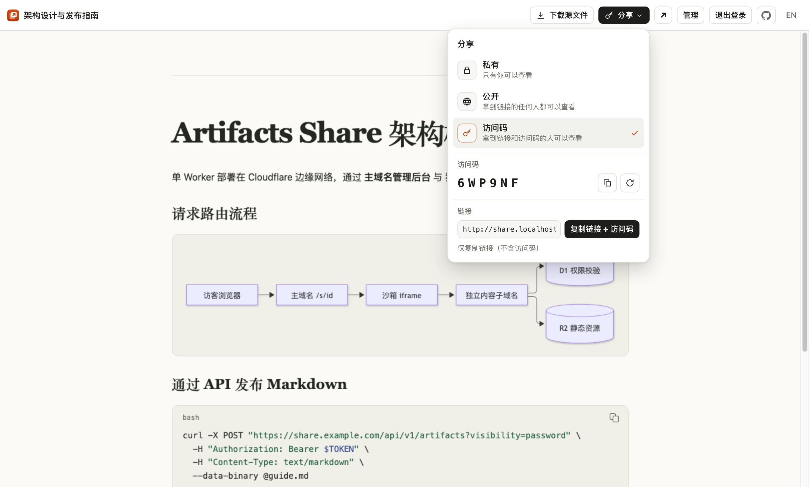
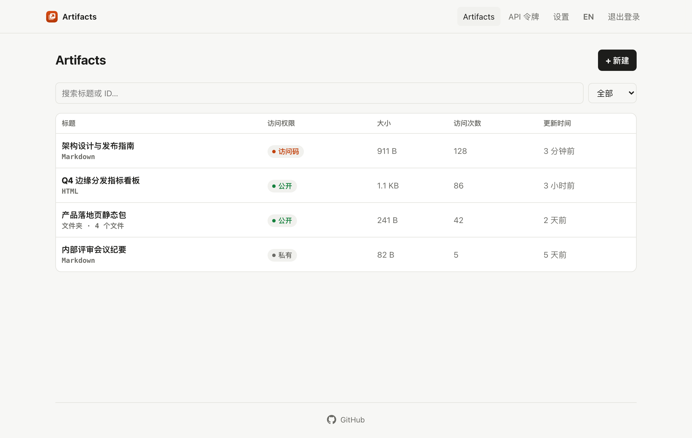
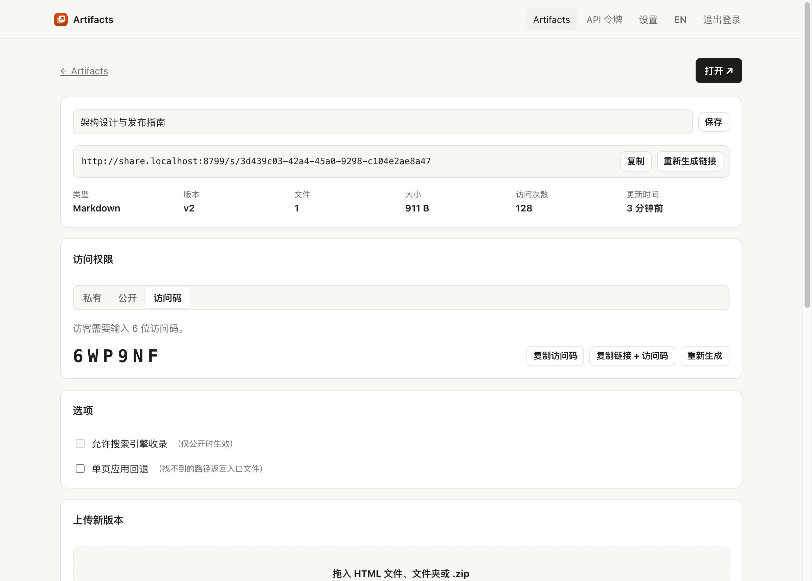
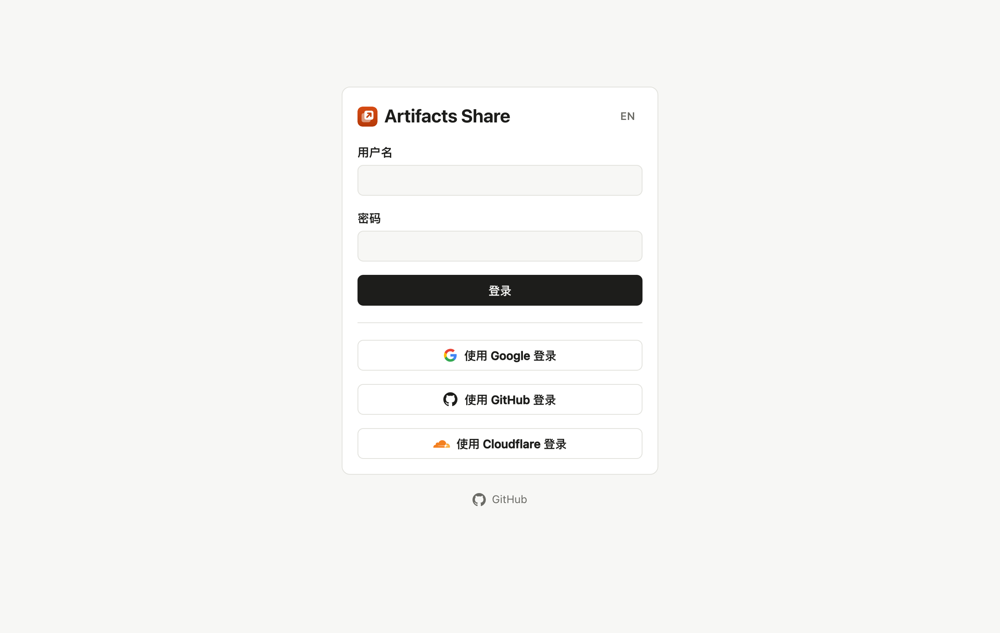

<p align="center">
  
</p>

# Artifacts Share

类似 claude.ai Artifacts 的单用户分享系统，运行在一个 Cloudflare Worker 上（D1 + R2）。

- 管理后台 + API：主域名，例如 `https://share.example.com`
- 分享链接：`https://share.example.com/s/{id}`。和 Claude Artifacts 一样，页面顶部是工具栏，下面用 iframe 加载内容
- 内容放在每个 artifact 独立的子域名：`https://{id}-share.example-content.com`，只允许被主域名的分享页嵌入
- 支持单 HTML、Markdown、文件夹和 ZIP；访问权限：私有、公开、访问码（6 位字母数字）
- 后台和访客页面支持中文 / English
- 登录：管理员密码 + 可选 SSO（Google / GitHub / Cloudflare Access，各绑定一个账号）
- API 用 Bearer Token 访问，Token 在后台管理

设计细节见 [docs/DESIGN.md](docs/DESIGN.md)。

## 界面预览

### 分享预览页（Markdown 渲染 / Mermaid / 快捷分享弹窗）



### 管理后台 · Artifacts 列表



### Artifact 详情与权限 / 版本管理



### 登录页（密码 + Google / GitHub / Cloudflare SSO）



## 部署

下文以 `share.example.com`（主域名）和 `example-content.com`（内容域名）为例，请替换成你自己的域名。

前提：

- 两个域名都作为 zone 接入**同一个** Cloudflare 账号，使用 Workers Paid 计划。
- 内容域名建议使用一个**独立的根域名**（与主域名不同站），这样 artifact 里的脚本无法带着后台登录态访问后台。

复制配置模板（`wrangler.toml` 不进 git），并修改其中的域名：

```bash
cp wrangler.toml.example wrangler.toml
```


```toml
routes = [
  { pattern = "share.example.com", custom_domain = true },
  { pattern = "*.example-content.com/*", zone_name = "example-content.com" },
]

[vars]
MAIN_HOST = "share.example.com"
CONTENT_ZONE = "example-content.com"
CONTENT_HOST_SUFFIX = "-share"   # 子域名 = {id}{后缀}.{CONTENT_ZONE}，可设为空
```

> 修改 `CONTENT_ZONE` 或 `CONTENT_HOST_SUFFIX` 后，所有 artifact 的链接会一起变化，旧链接失效。

```bash
npm install

# 1. 创建 D1 和 R2，把输出的 database_id 填进 wrangler.toml
npx wrangler d1 create artifacts-share
npx wrangler r2 bucket create artifacts-share

# 2. 密钥
openssl rand -base64 48 | npx wrangler secret put SECRET_KEY
npx wrangler secret put ADMIN_BOOTSTRAP_PASSWORD     # 首次登录用的临时密码

# 3. 建表并部署（deploy 会先执行 D1 迁移，再部署代码）
npm run deploy
```

> `npm run deploy` 总是先执行 `db:migrate:remote`：新代码可能依赖新的表结构，先部署代码会让上传失败。已执行过的迁移会被跳过。单独用 `wrangler deploy` 部署时，请先运行 `npm run db:migrate:remote`。

4. DNS：在内容域名的 zone（例如 `example-content.com`）添加 `*` → `AAAA 100::`，**开启代理（橙色云）**。
   主域名的记录由 Custom Domain 自动创建，无需手动添加。
5. 打开 `https://share.example.com`，用用户名 `admin`（或你设置的 `ADMIN_USERNAME`）和 bootstrap 密码登录，按提示设置用户名和正式密码（之后 bootstrap 密码失效）。用户名之后可以在"设置 → 安全"里修改。

### 可选：登录页 Turnstile 防护

在 Cloudflare 控制台创建 Turnstile 组件，主机名填**主域名和内容域名**（例如 `share.example.com` 和 `example-content.com`，后者用于访问码页），然后：

```toml
# wrangler.toml [vars]
TURNSTILE_SITE_KEY = "0x4AAA..."
```

```bash
npx wrangler secret put TURNSTILE_SECRET_KEY
```

同一 IP 失败 3 次后，必须先通过 Turnstile 验证。适用于后台登录，以及访问码的输入（访问码页、`?pwd=` 链接、下载弹窗）。启用 Turnstile 时，硬性锁定上限从 5 次提高到 10 次。两个值没配齐时不启用。

失败计数从第一次失败开始，计 10 分钟（存于 D1 的 `rate_limits` 表，过期记录由每日定时任务清理）。输错访问码时会提示还剩几次机会，锁定时提示需要等待的分钟数。

> `SECRET_KEY` 用于派生签名和加密密钥。更换它会让所有登录、访问码解锁失效，并需要重新填写 SSO client secret、重置所有访问码。

### 可选：访问统计（Workers Analytics Engine）

如需要时间趋势、独立访客（UV）、来源域名、地区、设备与下载统计，可在 `wrangler.toml` 开启 Analytics Engine 绑定并配置只读查询 Token（三项齐全时启用，缺任一项则自动隐藏统计入口）：

```toml
[[analytics_engine_datasets]]
binding = "ANALYTICS"
dataset = "artifacts_share_events"

# 添加到现有的 [vars] 段中：
CF_ACCOUNT_ID = "你的 Cloudflare Account ID"
# ANALYTICS_DATASET = "artifacts_share_events"   # 可选，需与上方 dataset 一致
```

```bash
# 自定义 Token 只需最小权限：Account → Account Analytics: Read
npx wrangler secret put CF_API_TOKEN
```

启用后顶栏会出现 **统计**（`#/analytics`）全站分析页，每个 artifact 详情页也会提供按需展开的 **访问统计** 折叠卡片（保留近 90 天明细）；同时每次访客浏览将跳过 D1 `view_count` 写入，列表页与详情页的访问次数异步读取 Analytics Engine 的近 90 天统计（不含爬虫）。未配置时仍使用 D1 `view_count`（并自动过滤爬虫与预加载）。

## SSO 配置

在后台 **Settings → Single sign-on** 中，每张卡片都显示回调地址，复制后到对应平台创建应用：

| Provider | 在哪里创建 | 后台需要填写 |
|---|---|---|
| Google | Google Cloud Console → APIs & Services → Credentials → OAuth client ID（Web application） | Client ID、Client secret |
| GitHub | GitHub → Settings → Developer settings → OAuth Apps | Client ID、Client secret |
| Cloudflare | Zero Trust → Access → Applications → SaaS → OIDC | Issuer、Client ID、Client secret |

保存并勾选 **Enable sign-in** → 点 **Bind account** 完成授权，即绑定当前账号。至少绑定一个 SSO 后，可以关闭密码登录。

**被锁在外面时**（例如关闭了密码登录且 SSO 不可用）：

```bash
npx wrangler d1 execute artifacts-share --remote \
  --command "DELETE FROM settings WHERE key IN ('admin_password_hash','admin_username','password_login_enabled')"
```

之后可以重新用初始用户名和 `ADMIN_BOOTSTRAP_PASSWORD` 登录。

## API 用法

在后台 **API tokens** 页创建 Token。

```bash
TOKEN=as_xxx
API=https://share.example.com/api/v1

# 单个 HTML
curl -X POST "$API/artifacts?title=Demo&visibility=public" \
  -H "Authorization: Bearer $TOKEN" -H "Content-Type: text/html" --data-binary @demo.html

# 单个 Markdown（分享页默认渲染，可切换源码）
curl -X POST "$API/artifacts?filename=notes.md" \
  -H "Authorization: Bearer $TOKEN" -H "Content-Type: text/markdown" --data-binary @notes.md

# 文件夹（multipart，filename 为相对路径）
curl -X POST "$API/artifacts?visibility=password" -H "Authorization: Bearer $TOKEN" \
  -F "file=@dist/index.html;filename=index.html" \
  -F "file=@dist/assets/app.js;filename=assets/app.js"

# zip（需先在 Settings 打开 Server-side zip extraction）
curl -X POST "$API/artifacts" -H "Authorization: Bearer $TOKEN" \
  -H "Content-Type: application/zip" --data-binary @site.zip

# 更新内容（生成新版本，链接不变）
curl -X PUT "$API/artifacts/$ID/content" -H "Authorization: Bearer $TOKEN" \
  -H "Content-Type: text/html" --data-binary @demo.html
```

重新生成链接（旧链接立即失效；`reset_password` 为 true 时同时重新生成访问码）：

```bash
curl -X POST "$API/artifacts/$ID/regenerate-link" -H "Authorization: Bearer $TOKEN" \
  -H "Content-Type: application/json" -d '{"reset_password": true}'
```

文件夹可以用 `entry` 指定 HTML 或 Markdown 入口。直接上传或分批上传时传 `source_kind=folder`（分批上传放在 JSON 请求体里），可以把单文件目录也保留为文件夹。

大文件夹用分批上传：`POST /uploads` → 逐个 `PUT /uploads/{id}/files/{path}` → `POST /uploads/{id}/commit`。完整接口列表见 [docs/DESIGN.md §8](docs/DESIGN.md)。

API 返回的 `url` 是分享链接（主域名 `/s/{id}`），`content_url` 是内容子域名的原始地址。

### 浏览 Markdown

在浏览器中打开 `.md` 或 `.markdown` 文件时，默认显示渲染预览，可切换到「源文件」。文件夹中的 Markdown 也一样，例如从 `README.md` 点开相对链接 `docs/guide.md`。相对链接和图片以当前文档所在目录为基准。

访问子目录地址（如 `docs/`）时，若没有 `docs/index.html`，可打开该目录下的 `index.md`、`index.markdown`、`README.md` 或 `README.markdown`。开启 SPA 回退的 HTML 应用仍用客户端路由处理这类路径。

脚本可从 `content_url` 对应的 Markdown 文件地址读取原文。`curl` 默认收到 `text/markdown`，也可以在文件地址加 `?__share_raw=1` 显式请求原文。内容仍受 artifact 的访问权限控制。

### 分享页与下载

访问码分享链接：`https://share.example.com/s/{id}?pwd=XXXXXX`（打开后自动解锁，并从地址栏去掉访问码）。

分享页顶部工具栏：
- 所有人：标题、复制链接、在新标签页打开、登录
- 下载：单个 HTML 或 Markdown 下载源文件，文件夹下载 ZIP（包括只有一个文件的文件夹）。所有者总是可以下载；访客需要先在设置里打开"允许访客下载"（默认关闭），访问码模式还要输入访问码
- 已登录（所有者）：另外可以切换访问权限（私有 / 公开 / 访问码）、查看、复制和重新生成访问码，进入管理页，以及退出登录

## 本地开发

```bash
cp wrangler.toml.example wrangler.toml   # 本地开发用示例配置即可
cp .dev.vars.example .dev.vars
npm run db:migrate:local
npm run dev        # http://share.localhost:8787 ，artifact 在 http://<uuid>-share.localhost:8787
npm test           # Workers 运行时内的集成测试
npm run typecheck
```

`wrangler dev` 在配置了 routes 时会把所有请求的 Host 改写成第一个路由，导致子域名路由失效，所以 `npm run dev` 会生成一份去掉 routes 的 `wrangler.dev.toml` 再启动。界面语言：后台默认跟随浏览器语言（无法识别时用中文），可在顶栏切换并记住选择；访客看到的访问码页 / 404 页按浏览器的 `Accept-Language` 自动选择。

用 Chrome 打开（Chrome 把 `*.localhost` 当作安全上下文，`__Host-` Cookie 才能生效）。

## 目录

```
src/index.ts          按 hostname 分发：管理端 / 内容端
src/main/             管理端：认证、OAuth、API（Hono）
src/content/          内容端：访问控制网关、R2 文件服务
src/lib/              加密、路径、存储、设置、zip、JWT
src/cron.ts           每日清理
migrations/           D1 表结构
web/                  管理后台（原生 JS，无构建）
test/                 集成测试
```
